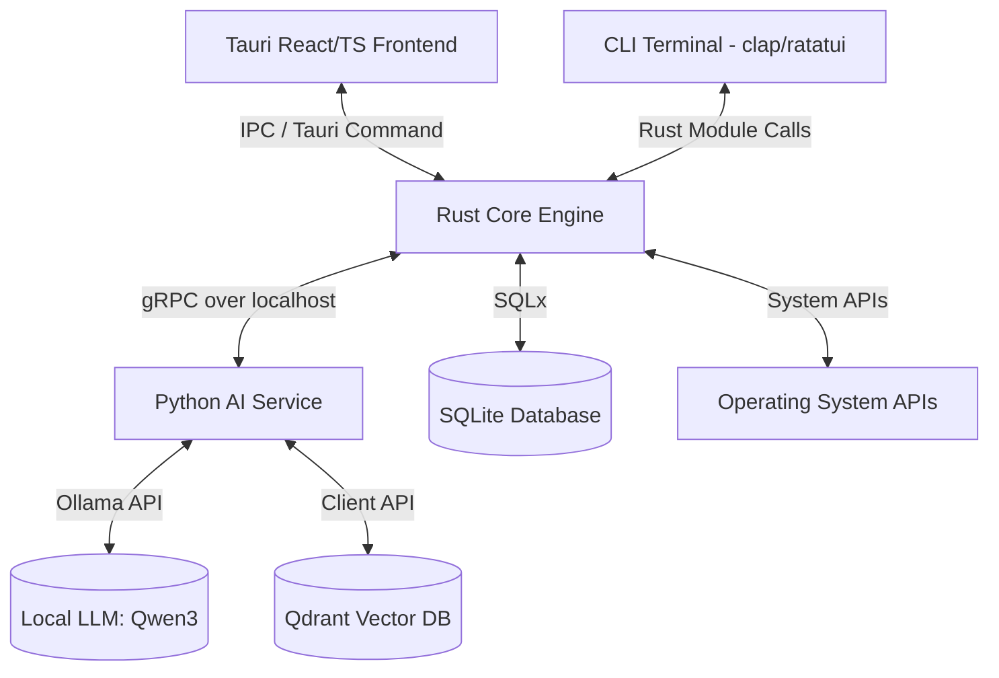

# PRISM System Architecture & Phase 1 Implementation Plan

## 1. Executive Summary & System Architecture

PRISM (Proactive Repair and Intelligent System Management) is designed as a production-grade, local, AI-powered system diagnosis and repair application. The core requirement is to bridge high-performance, low-level OS access (Rust) with advanced natural language reasoning (Python + Local LLM). 

### High-Level Architecture Diagram


### Module Responsibility Breakdown
1. **Desktop UI (`desktop-ui`)**: React + TypeScript client running inside a Tauri container. It communicates with the Rust backend via secure Inter-Process Communication (IPC) command handlers.
2. **Terminal (`terminal`)**: A professional Command Line Interface (CLI) built using `clap` and `ratatui` (Terminal User Interface library) that operates side-by-side with the GUI for power users.
3. **Core Engine (`core-engine`)**: The orchestration heart of PRISM. Written in Rust for type-safety and raw performance. It manages the state machine, routes commands, executes repairs, and triggers verification.
4. **AI Service (`ai-engine`)**: A Python microservice that encapsulates LLM client code, prompt templates, and reasoning logic. Python is chosen because of its dominant ecosystem in AI/ML and local integration with Ollama and Qdrant.
5. **Database (`database`)**: A local database module utilizing SQLite and SQLx to track repair logs, user options, and telemetry.
6. **Diagnostics (`diagnostics`)**: Low-level platform-specific inspectors (CPU, RAM, Processes, services, registry, network) using tools like `sysinfo` and native OS APIs.
7. **Scheduler (`scheduler`)**: A planning engine that parses tasks, schedules execution, and enforces dependency constraints (e.g., cannot restart a service while repairing permissions).
8. **Plugins (`plugins`)**: A modular plugin interface to extend PRISM's capabilities to external systems (Docker, Git, Database, etc.).
9. **Memory (`memory`)**: Local semantic memory management powered by Qdrant (or local Qdrant container/embedded) for historical repair pattern matching.

---

## 2. Why Python and Rust via gRPC?

To bridge the Rust Core and the Python AI Engine, we use **gRPC** (Google Remote Procedure Call) instead of REST/HTTP-JSON.

### Why gRPC?
- **Performance & Efficiency**: gRPC uses **HTTP/2** as its transport protocol, allowing multiplexing (multiple requests over a single TCP connection), header compression, and binary serialization (via Protocol Buffers). This translates to sub-millisecond network overhead for local inter-process communication.
- **Strict Interface Definition Language (IDL)**: Protocol Buffers (`.proto`) act as a single source of truth. We define the payload schemas and service methods once, and compile them into strongly-typed code in both Rust and Python. This eliminates runtime schema errors.
- **Streaming Support**: gRPC natively supports client streaming, server streaming, and bidirectional streaming. This is critical when streaming token-by-token responses from the local LLM to the Rust engine and UI.

### Why Rust for Core?
- **Memory Safety & Thread Safety**: Rust prevents memory leaks, data races, and segmentation faults at compile time, which is essential for code running with administrative system permissions.
- **Zero-Cost Abstractions**: Rust compiles directly to native machine code, running with minimal resource overhead.

### Why Python for AI Engine?
- **AI Ecosystem**: Python has first-class clients for Ollama, LangChain, PyTorch, and Qdrant. Leveraging this ecosystem saves thousands of lines of boilerplate.

---

## 3. Cargo Workspace Design

We organize the Rust codebase into a **Cargo Workspace**. Instead of a monolithic crate, each module is a distinct crate.

### Workspace Structure:
```text
PRISM/
├── Cargo.toml                  # Root Workspace configuration
├── proto/                      # Shared gRPC protocol definitions
│   └── prism.proto
├── core-engine/                # Main orchestrator library crate
│   ├── Cargo.toml
│   ├── build.rs                # Tonic-build protoc compilation script
│   └── src/
│       ├── lib.rs              # Exports Core components
│       └── client.rs           # gRPC Client implementation
├── terminal/                   # CLI binary crate (clap + ratatui)
│   ├── Cargo.toml
│   └── src/
│       └── main.rs
├── database/                   # SQLite database access crate
│   ├── Cargo.toml
│   └── src/
│       └── lib.rs
├── diagnostics/                # OS Inspection crate
│   ├── Cargo.toml
│   └── src/
│       └── lib.rs
├── scheduler/                  # Task scheduling engine crate
│   ├── Cargo.toml
│   └── src/
│       └── lib.rs
├── memory/                     # Semantic memory client crate (Qdrant)
│   ├── Cargo.toml
│   └── src/
│       └── lib.rs
├── plugins/                    # Extensible plugin system crate
│   ├── Cargo.toml
│   └── src/
│       └── lib.rs
├── ai-engine/                  # Python AI Service (non-Rust member)
│   ├── requirements.txt
│   ├── generate_protos.py      # Script to compile proto files for Python
│   └── src/
│       ├── main.py             # Python gRPC Server entrypoint
│       └── services/           # Service implementation handlers
│           └── intent.py
└── docs/                       # Project Documentation
    └── architecture_and_phase1.md
```

### Advantages of this layout:
- **Faster Compilations**: Changing code in one crate only recompiles that specific crate and its dependents, not the entire application.
- **Strict Boundaries**: Prevents spaghetti dependencies. For example, the `diagnostics` crate does not need to know about the `scheduler` or `memory` crates.
- **Clean Dependency Isolation**: The `database` crate depends on `sqlx`, while `diagnostics` depends on `sysinfo`, preventing binary bloat in other modules.

---

## 4. Phase 1 Goals & Deliverables

Our objective in Phase 1 is to establish the communication and project foundations. We will:
1. **Initialize the Cargo Workspace** and declare all member crates.
2. **Create the shared Protocol Buffers contract** (`proto/prism.proto`).
3. **Configure Rust Tonic** to compile protobuf schemas into Rust code at build time.
4. **Set up the Python AI Engine** with virtual environment, protobuf compiler, and a working gRPC server.
5. **Implement the Rust gRPC Client** inside `core-engine` to connect to the server.
6. **Implement robust logging and tracing** in both environments.
7. **Write integration tests** to verify that a client call successfully reaches the Python server, parses a test intent, and returns a structured response.

---

## 5. Development Details: "Why, What, How"

### Tonic (Rust gRPC Library)
- **Why**: `tonic` is a gRPC-over-HTTP/2 implementation based on `hyper` and `tokio`. It is the industry standard for Rust because of its performance, async-first design, and compatibility with the `prost` serialization framework.
- **Common Mistake**: Forgetting to install the Protocol Buffers Compiler (`protoc`) or configure the `PROTOC` environment variable. In Windows, this can cause the build to fail. We will utilize `prost-build` which can automatically bundle/download or use an existing installation.
- **Best Practice**: Use a `build.rs` script in Rust so that whenever the `.proto` file changes, Cargo automatically compiles the new definitions.

### Python gRPC & grpcio-tools
- **Why**: `grpcio` provides the runtime client/server implementation, and `grpcio-tools` provides the compiler to generate Python source files from `.proto` inputs.
- **Common Mistake**: Importing generated protobuf modules with incorrect package pathways, which leads to circular import or import-not-found errors. We will structure the python paths explicitly to avoid this.

---

## 6. Phase 1 Implementation Plan

We will execute the following steps in sequence:

1. **Step 1**: Rename and initialize directories. Set up `Cargo.toml` at the workspace root.
2. **Step 2**: Create the shared `proto/prism.proto` contract.
3. **Step 3**: Configure the Rust `core-engine` crate. Set up `Cargo.toml`, `build.rs`, and the client logic in `src/client.rs`.
4. **Step 4**: Initialize the other Rust crates (`database`, `diagnostics`, `scheduler`, `memory`, `plugins`, `terminal`) with basic dummy crates so the workspace compiles cleanly.
5. **Step 5**: Configure the Python `ai-engine` crate. Set up virtual environment, write `requirements.txt`, write a compile script, and build `main.py` containing the server.
6. **Step 7**: Verify and Test. Run the Python gRPC server, run a Rust bin/test client, verify logging outputs, and assert successful message roundtrip.
7. **Step 8**: Commit changes to Git.
