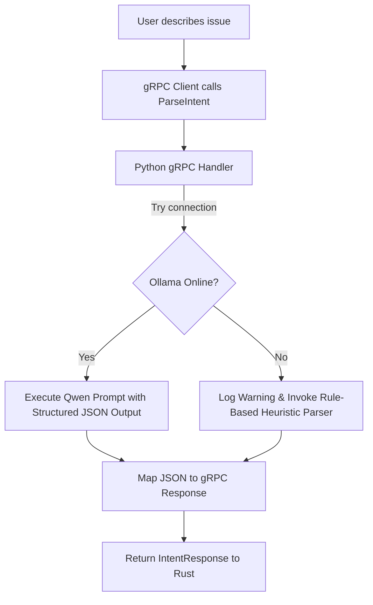

# Phase 2 Plan: Local LLM Integration via Ollama & Qwen

## 1. Objective

The goal of Phase 2 is to replace the mock heuristic intent parser in `ai-engine` with a robust Local LLM implementation powered by **Ollama** and the **Qwen** model (e.g., `qwen2.5:3b`). 

We will:
- Establish the LLM connector in the Python AI Engine.
- Design a structured prompt system for NLU (Natural Language Understanding) to extract intents and entities.
- Enforce structured JSON output from Ollama to ensure API payload compatibility.
- Implement **Graceful Degradation**: If Ollama is offline or uninstalled, the service automatically falls back to keyword heuristics, maintaining system uptime and testability.

---

## 2. Why Ollama and Qwen?

### Why Ollama?
- **Standardized Local API**: Ollama provides a simple local HTTP REST API for running open-source LLMs. It handles model loading, GPU acceleration (CUDA, ROCm, Apple Metal), and context management out-of-the-box.
- **Offline Privacy**: No data leaves the user's system. System diagnostics, process names, and user queries remain strictly local, which is a key security requirement for PRISM.

### Why Qwen (Qwen2.5)?
- **State-of-the-Art Small Language Model (SLM)**: The Qwen2.5 series (specifically the 3B and 7B variants) shows exceptional performance in reasoning, function calling, and structured JSON generation, rivaling much larger models while running efficiently on consumer laptops.
- **Multi-lingual & System Commands Friendly**: It possesses solid understanding of operating system commands, system errors, and developer jargon.

---

## 3. Graceful Degradation Strategy

In enterprise software, external dependencies (like a local database, daemon, or microservice) can fail. If a user runs PRISM but has not started the Ollama service, the application should **never** crash.



This strategy ensures:
1. **Developer Velocity**: You can test the application compilation, integration, and IPC without having to download a 2GB model or run the Ollama daemon.
2. **Resilience**: The frontend can notify the user ("Ollama is offline. Running in basic heuristics mode.") instead of presenting a blank screen or a connection error.

---

## 4. Prompt Engineering & Structured Outputs

We will instruct the model using a system prompt and request the response in JSON format.

### Schema Requirements:
We require the LLM to output a JSON object containing:
- `intent`: One of the supported system intents (e.g., `optimize_ram`, `network_reset`, `clean_junk`, `unknown`).
- `confidence`: A float between 0.0 and 1.0.
- `entities`: A key-value dictionary containing parameters extracted from the user's command.
- `reasoning`: A single-sentence explanation of why it made this decision.

### System Prompt Design:
```text
You are the natural language understanding (NLU) core of PRISM, an autonomous OS management engine.
Your task is to parse the user's query and categorize their request into a system intent, extract entities, and provide a reasoning.

Supported Intents:
- optimize_ram: User mentions memory issues, lag, high RAM usage, or specific processes eating RAM.
- network_reset: User mentions Wi-Fi, Internet, network dropouts, DNS, or connectivity.
- clean_junk: User mentions temporary files, junk, disk space, storage cleanup, or freeing gigabytes.
- unknown: Any query that does not fall into the above categories.

Output MUST be a valid JSON object matching the following structure:
{
  "intent": "intent_string",
  "confidence": 0.0-1.0,
  "entities": {
     "target_process": "process name if mentioned",
     "target_disk": "drive letter if mentioned",
     "target_free_space": "size mentioned, e.g. 20GB",
     "target_service": "service name if mentioned"
  },
  "reasoning": "Brief explanation."
}
Do not return any conversational text outside the JSON block.
```
