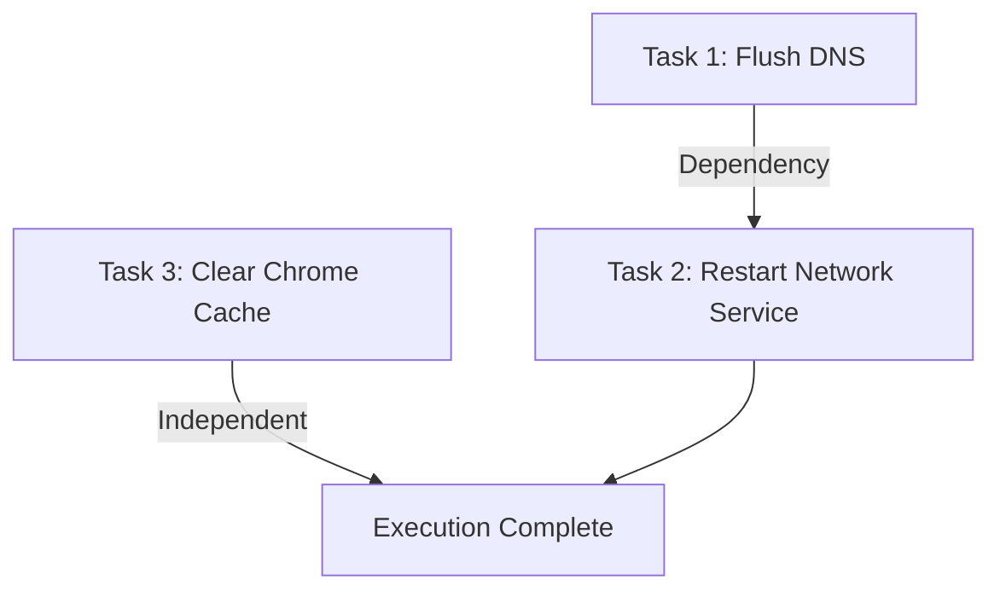

# Phase 5 Plan: Task Scheduler & Repair Execution Engine

## 1. Objective

The goal of Phase 5 is to implement the execution layer of PRISM: the **Task Scheduler and Repair Engine** (`scheduler` crate). 

We will:
- Define the Rust execution adapters for tasks generated by the Python Reasoning Engine:
  - `kill_process`: Gracefully terminates processes.
  - `delete_file`: Safely clears junk folders.
  - `run_command`: Executes platform-specific configurations.
  - `restart_service`: Manages operating system services.
- Implement a **Topological Sort** engine using a dependency resolver (Directed Acyclic Graph or DAG scheduler). This ensures tasks run in order of their declarations (e.g. DNS flushing before ping testing).
- Connect the `scheduler` crate to our `terminal` client. After the user reviews and confirms the diagnosis action plan, the client triggers the execution loop, executing tasks and reporting execution results.
- Write unit and integration tests to verify successful task execution.

---

## 2. Dynamic Task Execution Rules

Each task type executes with strict defensive boundaries:
- **`kill_process`**:
  - Tries to terminate via PID first. If PID is `0` or fails, searches for process by name and terminates it.
- **`delete_file`**:
  - Restricts deletion paths to specific safe zones (e.g. system temporary folder paths) to prevent accidental OS file deletions.
- **`run_command`**:
  - Limits execution time to prevent hanging shells. Only runs safe system utilities (e.g. `ipconfig`, `netsh`, `ping`).
- **`restart_service`**:
  - Executes Windows-specific administrative commands (`sc.exe` or `powershell`) to stop and start services.

---

## 3. Dependency DAG Orchestration

The task scheduler parses a list of tasks containing dependencies. We resolve dependencies using a classic topological sorting algorithm (Kahn's algorithm):

If a cycle is detected, we log an error and abort the plan to guarantee system safety.
