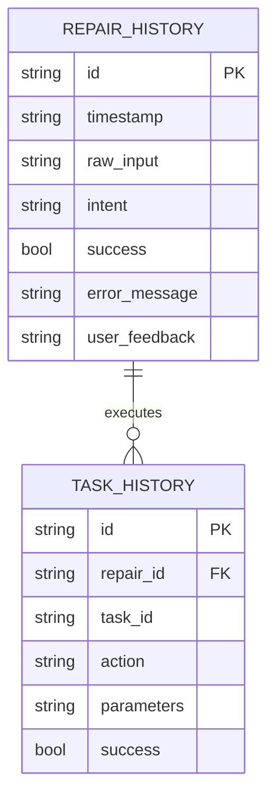

# Phase 7 Plan: Learning Loop & Database Engine

## 1. Objective

The goal of Phase 7 is to implement the **Learning Loop & Local Database Engine** inside PRISM. This binds the execution phase back to a persistent memory store, completing the full feedback loop: **Sense -> Think -> Act -> Learn**.

We will:
- Implement a local SQL storage provider using SQLite in the `database` crate to record execution history.
- Write database schemas for `repair_history` and `task_history` to track query parameters, intent mappings, execution success states, error logs, and user feedback.
- Connect `core-engine` to invoke the `LearnFromRepair` gRPC endpoint in the Python `ai-engine`.
- Implement `LearnFromRepair` inside the Python service to ingest execution telemetry.
- Update the `terminal` client to call both our local SQLite engine and the Python gRPC endpoint after task execution, verifying that success and failure events are recorded.

---

## 2. Database Schema

We use two primary tables to store execution parameters:

---

## 3. The Feed-Forward Learning Loop

By logging task execution failures (like the service restart failing due to permission limitations), the AI reasoning engine can query historical trends in future diagnostic sessions to:
1. Detect persistent system obstacles.
2. Avoid repeating execution paths that repeatedly fail.
3. Suggest administrative elevation prompts to the user when service restarts fail.
