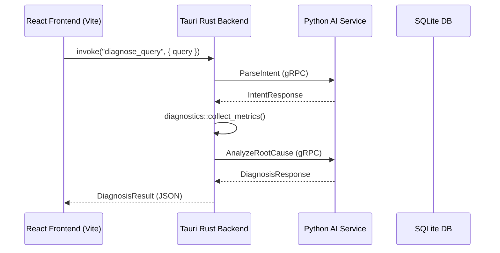

# Phase 8 Plan: Tauri Desktop UI Integration

## 1. Objective

The goal of Phase 8 is to implement the **Desktop User Interface** inside the `desktop-ui` package, wrapping the Rust backend engine using **Tauri v2** and **Vite + React + TypeScript**.

We will:
- Initialize the Tauri application structure in `desktop-ui`.
- Write the backend Tauri command handlers (`get_system_telemetry`, `diagnose_query`, `run_repair`, `get_recent_failures`).
- Configure Tonic and Protos to generate structs deriving `serde::Serialize` and `serde::Deserialize` for type-safe IPC communication.
- Design a premium carbon-slate dark theme dashboard with custom CSS glassmorphism styling.
- Build interactive sub-views:
  1. **System Monitor**: Visual resource gauges for CPU/RAM/Disk and a process resource list.
  2. **AI Diagnose Studio**: A search-style console box linked to the LLM reasoning pipeline to display root causes and DAG action plans.
  3. **History Logs**: An inspect table fetching SQLite failures.

---

## 2. Interface Layer (Tauri IPC)

Tauri routes JSON payloads between the React webview context and native Rust execution threads:

---

## 3. Design Aesthetics & Visual Tokens

The frontend uses custom CSS variables defined in `App.css`:
- **Background**: Deep carbon slate blue (`#0B0E17`) with blurred radial indigo glow accents.
- **Components**: Glassmorphism containers with semi-transparent borders.
- **Dynamic States**: Pulsing animations for running tasks, green checkmarks for completed fixes, and amber warning badges for blocked/unsafe operations.
